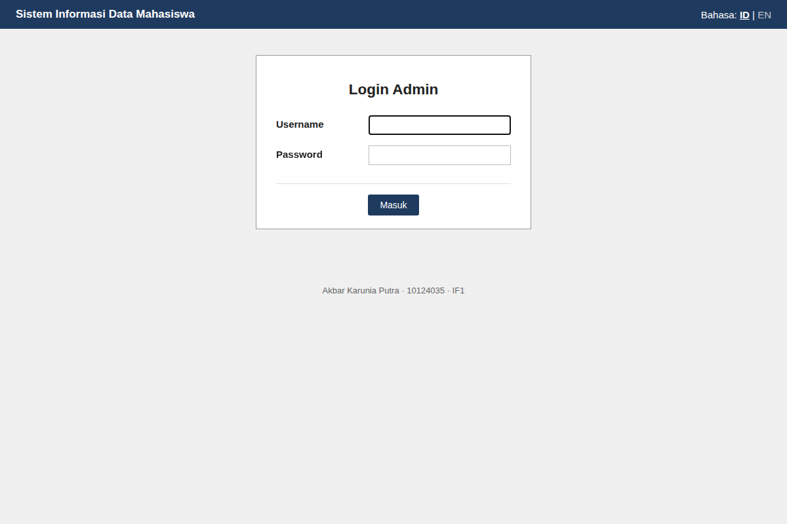
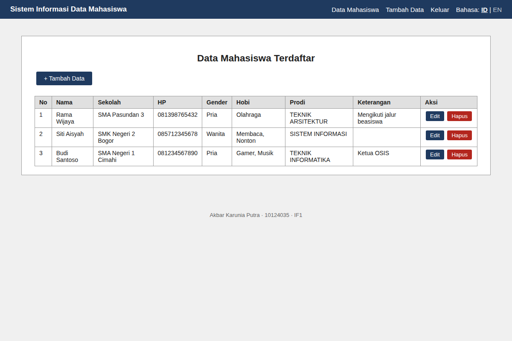
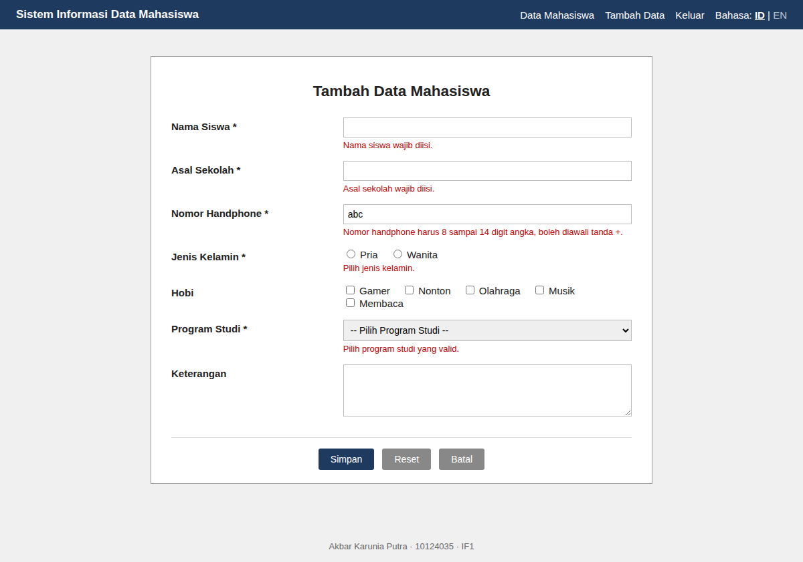
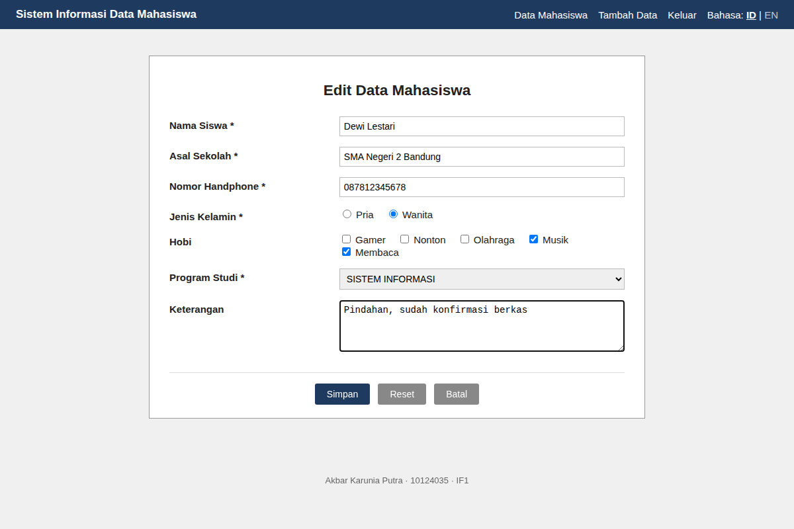
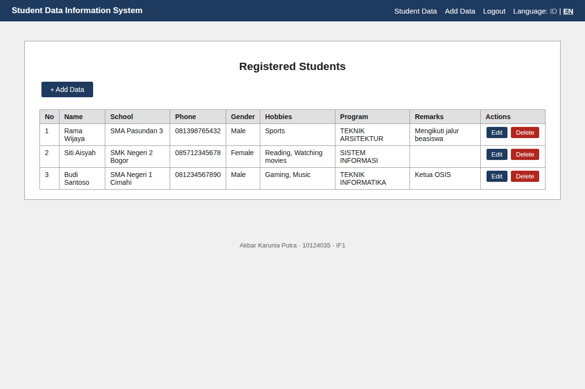

# Sistem Informasi Data Mahasiswa

Aplikasi web sederhana untuk mengelola data pendaftaran mahasiswa: tambah, lihat, ubah, dan hapus data. Dibangun dengan **PHP murni** dan **MySQL/MariaDB**, dilengkapi sistem login berbasis `$_SESSION` dan dukungan dua bahasa antarmuka (Indonesia dan Inggris).

> Tugas 2, Membuat Sistem Informasi Manajemen Data Sederhana
> **Nama:** Akbar Karunia Putra &nbsp;|&nbsp; **NIM:** 10124035 &nbsp;|&nbsp; **Kelas:** IF1

---

## Tangkapan Layar

| Halaman login | Daftar data |
|---|---|
|  |  |

| Validasi form | Ubah data |
|---|---|
|  |  |

| Antarmuka Bahasa Inggris |
|---|
|  |

---

## Fitur

- **Login dan proteksi halaman:** halaman CRUD hanya bisa diakses setelah login dengan `$_SESSION`.
- **Create:** tambah data mahasiswa melalui formulir POST.
- **Read:** menampilkan seluruh data dalam tabel HTML, dari data terbaru.
- **Update:** mengubah data berdasarkan `id` unik.
- **Delete:** menghapus data dengan konfirmasi sebelum dikirim.
- **Validasi:** setiap kolom diperiksa di sisi server dengan struktur if-elseif sebelum disimpan.
- **Dua bahasa:** Indonesia dan Inggris. Pilihan disimpan di `$_SESSION` sehingga konsisten saat berpindah halaman.

## Teknologi

- PHP 8.x dengan PDO
- MySQL / MariaDB
- HTML5 dan CSS3, tanpa framework

## Struktur Proyek

```
.
├── db_kampus.sql          Skrip database (tabel, data contoh, akun admin)
├── koneksi.php            Koneksi PDO ke database
├── fungsi.php             Escape output, validasi, CSRF, flash message, login, bahasa
├── lang.php               Kamus terjemahan ID/EN dan fungsi t()
├── templat_atas.php       Header dan navigasi
├── templat_bawah.php      Footer
├── form_mahasiswa.php     Formulir yang dipakai tambah.php dan edit.php
├── login.php              Halaman login
├── logout.php             Keluar dari sistem
├── ganti_bahasa.php       Ganti bahasa ID/EN
├── index.php              Daftar data (Read)
├── tambah.php             Tambah data (Create)
├── edit.php               Ubah data (Update)
├── hapus.php              Hapus data (Delete)
├── style.css              Gaya tampilan
└── screenshots/           Tangkapan layar untuk README
```

## Instalasi

### Prasyarat

- [XAMPP](https://www.apachefriends.org/) (Apache dan MySQL), atau PHP 8.x dan MySQL/MariaDB yang terpasang sendiri

### Langkah (XAMPP)

1. Salin folder proyek ini ke `htdocs`:
   - Windows: `C:\xampp\htdocs\`
   - macOS: `/Applications/XAMPP/htdocs/`
   - Linux: `/opt/lampp/htdocs/`
2. Jalankan **Apache** dan **MySQL** dari XAMPP Control Panel.
3. Impor database. Buka `http://localhost/phpmyadmin`, pilih **Import**, lalu pilih `db_kampus.sql` dan klik **Go**.
   Alternatif lewat terminal: `mysql -u root -p < db_kampus.sql`
4. Buka aplikasi di browser: `http://localhost/Tugas2_10124035_Akbar_Karunia_Putra_IF1/`

### Alternatif: PHP built-in server

```bash
mysql -u root -p < db_kampus.sql
php -S localhost:8000
```

Lalu buka `http://localhost:8000/`.

### Konfigurasi koneksi

Pengaturan database ada di `koneksi.php`:

```php
$host     = "localhost";
$nama_db  = "db_kampus";
$username = "root";
$password = "";   // Kosongkan jika memakai pengaturan bawaan XAMPP
```

Ubah nilainya jika MySQL Anda memakai user atau password lain.

## Akun Default

| Username | Password |
|---|---|
| `admin` | `admin123` |

Akun ini hanya untuk pengujian. Ganti password sebelum digunakan di lingkungan nyata.

## Keamanan

- **Prepared statement** di semua kueri untuk mencegah SQL Injection.
- **`htmlspecialchars()`** lewat fungsi `e()` pada setiap output untuk mencegah XSS.
- **Sanitasi dan whitelist** input: tag HTML dibuang, dan jenis kelamin, prodi, serta hobi hanya diterima jika ada dalam daftar pilihan.
- **Token CSRF** pada setiap formulir yang mengubah data.
- **Password di-hash** dengan bcrypt (`password_hash()` dan `password_verify()`).
- **Regenerasi ID sesi** saat login dan logout untuk mencegah session fixation.

## Penulis

**Akbar Karunia Putra**, NIM 10124035, kelas IF1.

Dibuat sebagai tugas kuliah.
